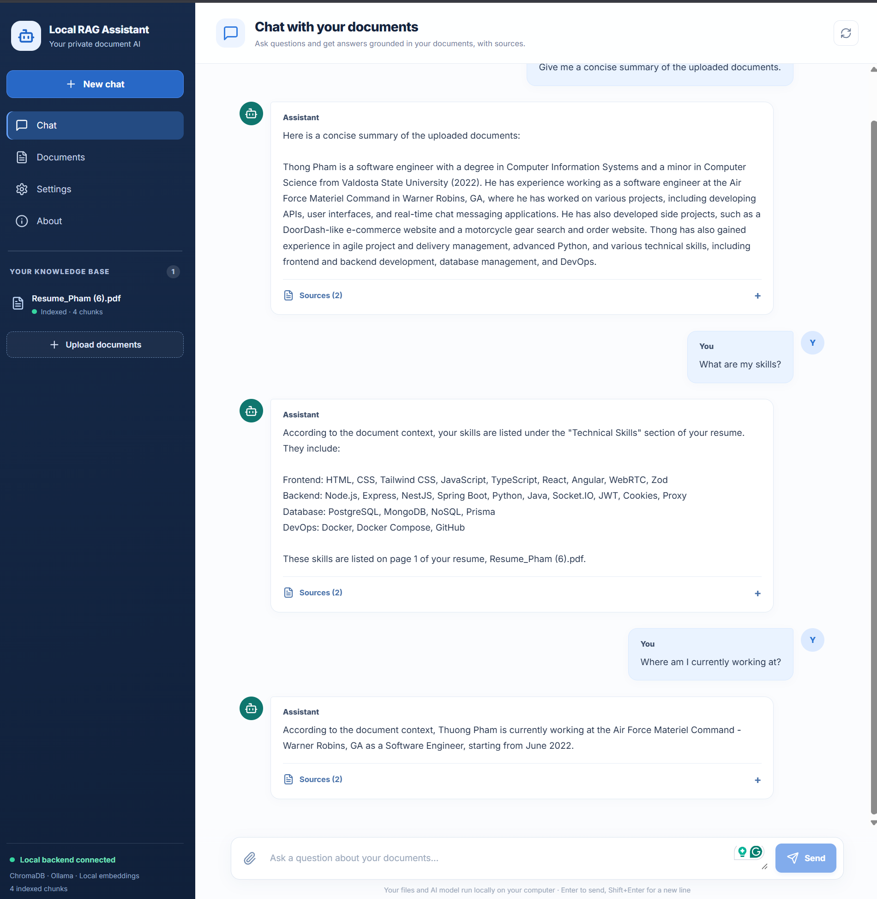

# Local RAG Assistant

A local-first document assistant that lets you upload PDFs, ask questions about their contents, and review the sources behind each answer. The main version is a React web app backed by a FastAPI service, ChromaDB, local embeddings, and Ollama.

## Demo



## Features

- Upload and index one or more PDF files in the browser.
- Ask questions grounded in the uploaded documents.
- View source filenames, page numbers, and excerpts alongside answers.
- Keep uploaded PDFs, the vector database, and model inference on your machine.
- Use the included Tkinter/command-line prototype in `version2_GUI/` as an alternative implementation.

Only PDFs with extractable text are supported; scanned documents need OCR before uploading. The web app accepts PDF files up to 40 MB each.

## Technology

- **Frontend:** React, TypeScript, Vite
- **Backend:** Python, FastAPI, Uvicorn, PyMuPDF
- **Embeddings:** `sentence-transformers/all-MiniLM-L6-v2`
- **Vector store:** ChromaDB, persisted locally
- **Chat model:** `llama3.2:3b` through Ollama

## Requirements

- Python 3.10 or newer
- Node.js and npm
- [Ollama](https://ollama.com/) installed

Download the chat model before starting the app:

```powershell
ollama pull llama3.2:3b
```

Ollama must be running while you chat. On installations where Ollama does not start automatically, start it with `ollama serve`. The embedding model is downloaded automatically the first time a PDF is indexed.

## Run the web app

Start the backend in a PowerShell terminal:

```powershell
cd .\version1_web_Brownser\backend
py -m venv .venv
.\.venv\Scripts\Activate.ps1
python -m pip install -r requirements.txt
uvicorn app.main:app --reload
```

In a second terminal, install and start the frontend:

```powershell
cd .\version1_web_Brownser\frontend
npm install
npm run dev
```

Open the local address printed by Vite (by default, `http://127.0.0.1:5173`). Keep both the backend and frontend terminals running.

## How it works

1. The backend extracts text from each uploaded PDF page with PyMuPDF and splits it into overlapping chunks.
2. Sentence Transformers creates normalized embeddings for the chunks, which are saved in a local ChromaDB collection.
3. For each question, the backend retrieves up to five relevant chunks and sends them with the question to the local Ollama model.
4. The response includes source information so you can check which document pages support the answer.

The web app stores its uploaded files, document registry, and ChromaDB data under `version1_web_Brownser/backend/data/`.

## Repository layout

```text
version1_web_Brownser/
  backend/
    app/main.py       FastAPI API and PDF indexing/chat logic
    data/             Local uploads, document registry, and vector database
    requirements.txt  Backend Python dependencies
  frontend/
    src/              React application
    package.json      Frontend dependencies and scripts
  demo.png            Screenshot used above

version2_GUI/
  gui.py              Tkinter desktop prototype
  ingest.py           Command-line PDF indexing prototype
  query.py            Command-line question-answering prototype
```
